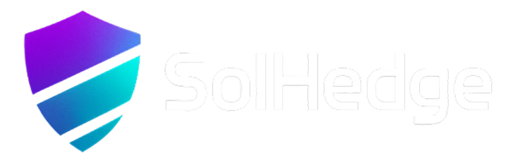
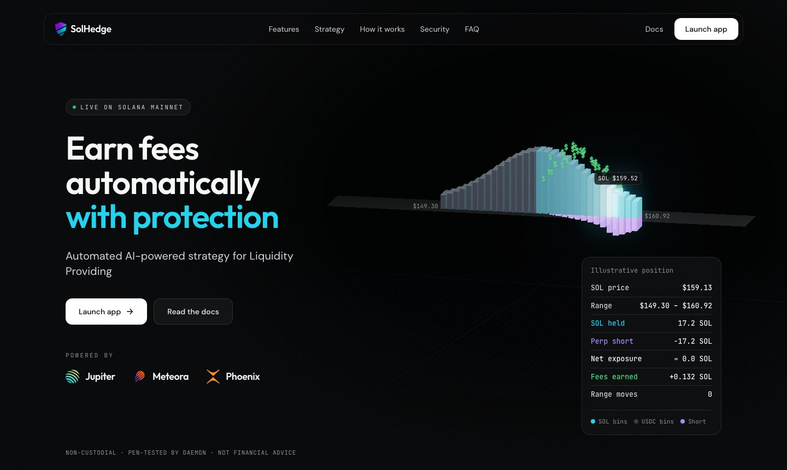

<p align="center">
  
</p>

<h3 align="center">Earn fees automatically, with protection.</h3>

<p align="center">
  AI-managed liquidity providing on Solana.<br />
  <a href="https://solhedge.xyz">Website</a> ·
  <a href="https://app.solhedge.xyz">Launch app</a> ·
  <a href="https://docs.solhedge.xyz">Docs</a>
</p>



## What SolHedge does

Providing liquidity on Meteora DLMM earns trading fees, but it's a full-time job. Price
leaves your range and fees stop. Price falls and impermanent loss eats what you earned.
Fees sit unclaimed instead of compounding.

SolHedge runs that job for you. Deposit into a pool, activate the portfolio, and the AI
takes over four things you'd otherwise do by hand:

| | |
| --- | --- |
| **Auto-hedge** | Opens an offsetting perpetual short when risk signals confirm, cutting directional exposure and impermanent loss. |
| **Auto-range** | Moves your range boundaries with the price, using volatility and momentum signals, so liquidity stays where the trades are. |
| **Auto-rebalance** | Redistributes liquidity inside your range as the market shifts, without closing and reopening positions. |
| **Auto-compound** | Harvests earned fees and puts them straight back to work. |

## One decision engine, three modes

| Mode | Market | What happens |
| --- | --- | --- |
| **Calm** | Healthy | Liquidity is fully deployed and earning fees. No hedge. |
| **Caution** | Early risk signals | A partial hedge switches on while fees keep accruing. |
| **Defensive** | Multiple signals confirm | Liquidity moves to stablecoins until conditions settle. |

The engine is fast to protect and slow to relax, so it doesn't whipsaw in and out of hedges.

## How it works

1. **Connect** a Solana wallet at [app.solhedge.xyz](https://app.solhedge.xyz).
2. **Pick a pool and deposit.** Most capital goes into Meteora DLMM at an AI-selected range; a reserve stays ready for hedging.
3. **Activate** range, hedge, rebalance and compound management.
4. **Earn.** Fees accrue around the clock. Check the dashboard anytime, and withdraw whenever you want.

## Built with

[Meteora](https://meteora.ag) for concentrated liquidity, [Jupiter](https://jup.ag) for spot and
perpetuals routing, and [Phoenix](https://phoenix.trade) on Solana. Supported by Superteam Indonesia.

> Protected isn't risk-free. Returns vary with market conditions and no fixed APY is
> guaranteed. Nothing here is financial advice.

---

<details>
<summary>Run this landing page locally</summary>

```bash
npm ci
npm run dev     # http://localhost:5173
npm run build   # typecheck + production build into dist/
```

React, Vite, Tailwind CSS and three.js.
</details>
